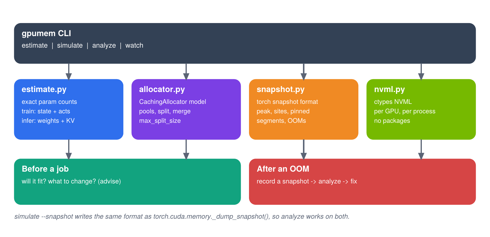

# gpu-memory-profiler (`gpumem`)

[](https://github.com/tahsin-ts/gpu-memory-profiler/actions/workflows/ci.yml)

Predict, simulate and explain GPU memory for PyTorch workloads, before and after `CUDA out of memory`.

| Command | What it does |
|---|---|
| `gpumem estimate` | Memory a training or inference job needs: weights, gradients, optimizer, activations, logits, KV cache. Exact parameter counts for GPT-2 and Llama models. Suggests changes until it fits. |
| `gpumem simulate` | Runs a workload through a simulator of PyTorch's CUDA caching allocator to reproduce and explain fragmentation. |
| `gpumem analyze` | Explains a snapshot from `torch.cuda.memory._dump_snapshot()` (or from the simulator): peak, what was alive at the peak, by code location, and which segments are pinned. |
| `gpumem watch` | Per-GPU and per-process memory straight from the NVIDIA driver (NVML, via ctypes). |

No dependencies beyond Python 3.10+. PyTorch is needed only to record snapshots of real jobs.



## Examples

```bash
pip install .
gpumem estimate --model llama2-7b --seq 4096 --gpus 8 --gpu-gib 80
gpumem estimate --model llama3-8b --mode infer --batch 8 --seq 8192
gpumem simulate --capacity-gib 6 --snapshot frag.pkl     # OOM caused by fragmentation
gpumem simulate --capacity-gib 6 --max-split-mb 128      # same workload, completes
gpumem analyze frag.pkl
```

```text
$ gpumem simulate --capacity-gib 6
completed 96/300 steps | peak allocated 4.74 GiB | peak reserved 5.96 GiB | allocation retries 4 | OOMs 1
CUDA out of memory. Tried to allocate 127.84 MiB. ... 4.62 GiB is allocated by PyTorch, and 1.35 GiB is
reserved by PyTorch but unallocated. Largest cached free block: 121.38 MiB. ...
```

The job needed at most 4.74 GiB, yet failed on a 6 GiB device: long-lived 6 MiB tensors were carved out of
cached 128 MiB activation blocks and pinned them. `gpumem analyze` lists exactly those segments.

## Recording a real job

```python
from gpumem.torch_hooks import record
with record("train.pickle"):
    train_a_few_steps()
# then: gpumem analyze train.pickle   (the same file opens at https://pytorch.org/memory_viz)
```

## Deploy

`deploy/k8s/gpumem-watch.yaml` runs `gpumem watch` as a DaemonSet on GPU nodes.

## Notes

The allocator simulator follows the rules of PyTorch's `CUDACachingAllocator` (512 B rounding, 1 MiB small-pool
limit, 2 MiB / 20 MiB segments, best fit, split thresholds, cache release before OOM, `max_split_size`). It is a
model for learning and planning, not a byte-exact copy of every PyTorch version. The activation estimate uses
Korthikanti et al. (2022) and is approximate for SwiGLU models.

## License

MIT
